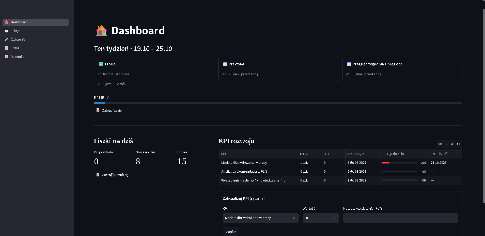
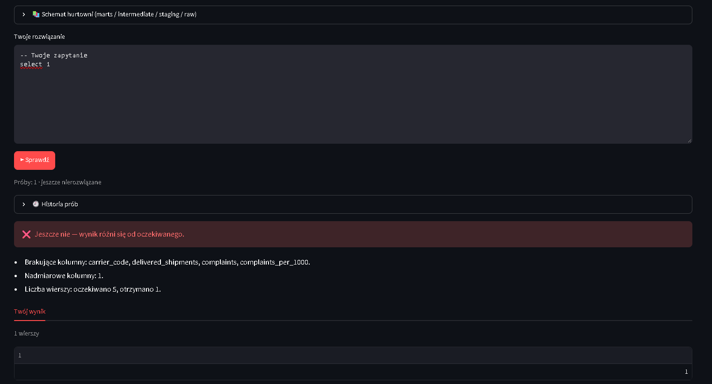
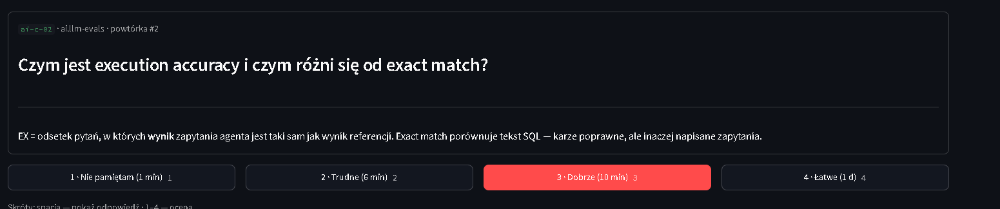
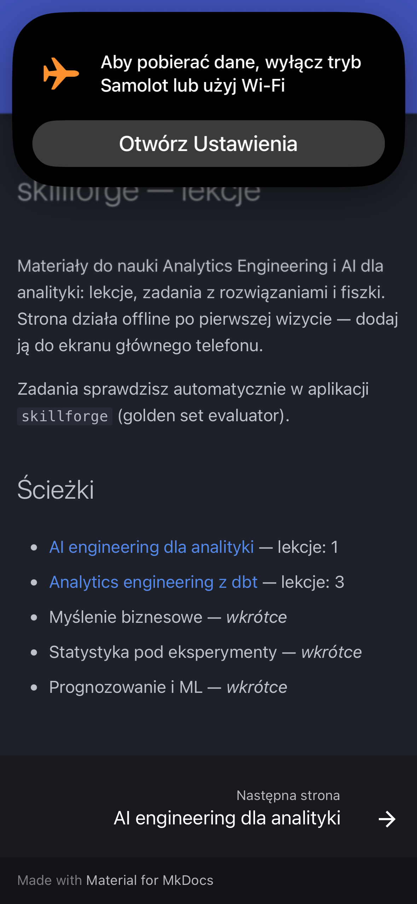
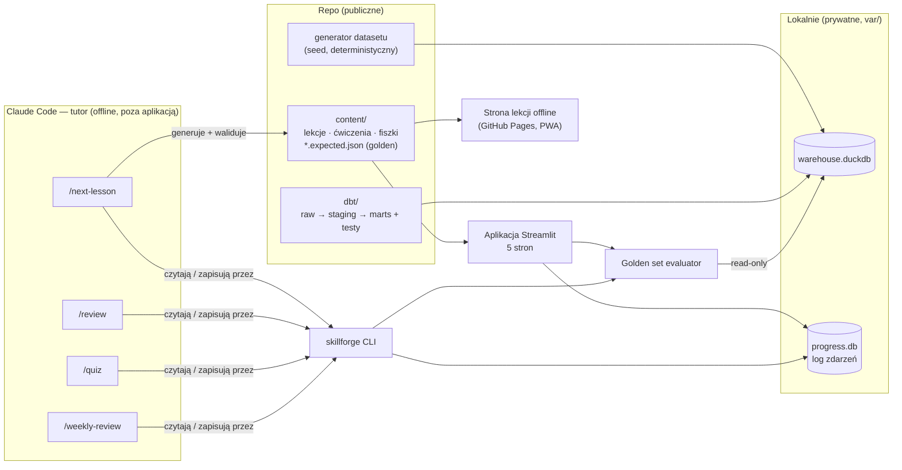

# skillforge

Lokalna aplikacja do nauki **Analytics Engineering + AI dla analityki** — zbudowana jako projekt
portfolio i jednocześnie narzędzie, którego używam do własnego rozwoju.

- **Lekcje** (15–20 min) zawsze z sekcją „Jak zastosować w pracy”.
- **Ćwiczenia SQL i Python sprawdzane automatycznie** przez *golden set evaluator* na syntetycznej
  hurtowni logistyki e-commerce zbudowanej w **dbt** (raw → staging → marts, z testami).
- **Fiszki** z powtórkami **FSRS**, dzienna kolejka.
- **Tracker**: drzewo kompetencji (poziomy 0–3), rytm tygodnia, KPI rozwoju, brag doc z eksportem.
- **Zero LLM w runtime i zero kosztów API.** Tutorem jest Claude Code przez komendy w
  `.claude/commands/` — generuje treści do repo, a aplikacja je wyświetla, sprawdza i śledzi postęp.
- **Telefon:** lekcje jako strona offline na GitHub Pages + pełna aplikacja przez Tailscale.

## Zrzuty ekranu

| Dashboard: rytm tygodnia, fiszki na dziś, KPI | Ćwiczenie: czytelny diff wyniku |
|---|---|
|  |  |

| Fiszki z powtórkami FSRS | Strona lekcji offline (telefon w trybie samolotowym) |
|---|---|
|  |  |

*Zrzuty z trybu demo: przykładowy profil (`profile.example.yaml`) i dane fikcyjne.*

## Architektura



| Warstwa | Technologia | Dlaczego |
|---|---|---|
| Dane ćwiczeń | DuckDB + dbt-duckdb | hurtownia w jednym pliku; dbt uczy się na własnym projekcie |
| Postęp | SQLite, **append-only log zdarzeń** | wiele małych zapisów z kilku procesów; synchronizacja urządzeń bez konfliktów |
| UI | Streamlit | szybkie UI w Pythonie, testy przez `AppTest` |
| Powtórki | FSRS (`fsrs`) | lepszy niż SM-2 przy nieregularnym rytmie (2–3 sesje w tygodniu) |
| Telefon | MkDocs Material + service worker; Tailscale | lekcje offline bez serwera; pełna aplikacja w prywatnej sieci |
| Jakość | ruff, mypy `--strict`, pytest, CI na Ubuntu i Windows | |

Wszystkie decyzje (jedna linijka każda): [`DECISIONS.md`](DECISIONS.md). Co dalej: [`ROADMAP.md`](ROADMAP.md).

## Golden set evaluator

Moduł `src/skillforge/evaluator/` sprawdza ćwiczenia — i jest zaprojektowany tak, żeby w kolejnej
fazie ten sam kod oceniał **odpowiedzi agenta text-to-SQL**. To ten sam wzorzec co ewaluacja LLM:

```
GoldenCase  = pytanie + rozwiązanie referencyjne + ZAMROŻONY oczekiwany wynik + CompareSpec
Candidate   = dowolna odpowiedź: człowiek (UI/CLI) · referencja (walidacja w CI) · LLM (następna faza)
evaluate(case, candidate) → EvalResult(passed, score, diff, error, duration)
run_suite(cases, provider) → SuiteReport(pass_rate, mean_score, failed)
```

**Jak porównuje wyniki** (`compare.py`, ustawienia per ćwiczenie w `compare:`):

- kolejność wierszy bez znaczenia (chyba że `order_matters: true`),
- liczby z tolerancją (`rel_tol=1e-6`, `abs_tol=1e-9`), `Decimal`/daty normalizowane,
- kolumny dopasowane po nazwie bez wielkości liter (albo po pozycji),
- **multizbiór** — duplikaty się liczą, więc fan-out po JOIN to błąd, a nie kosmetyka,
- czytelny diff: brakujące / nadmiarowe wiersze, „ten sam wiersz, inna wartość w kolumnie X”,
  podpowiedzi typu *brak aliasu?*, *duplikaty po JOIN?*, *sprawdź ORDER BY*.

**Jak pilnuje jakości samego golden setu:**

- `*.expected.json` jest **zamrożony** i przeglądany jak kod; CI buduje hurtownię od zera
  (Ubuntu i Windows) i wymaga, by każda referencja odtworzyła swój wynik — dryf danych lub
  zmiana referencji nie przesunie poprzeczki po cichu,
- każde ćwiczenie ma **negatywne kontrolki** (`negatives`) — typowe błędne odpowiedzi, które
  muszą oblać. Złapały m.in. błąd, którego nie dało się wykryć na pierwotnych danych:
  `count(distinct shipment_id)` dawało ten sam wynik co poprawna deduplikacja, a zmiana SLA
  wypadała w niedzielę bez odbiorów, więc błąd „`valid_to` włącznie” był niewidoczny.
  Execution accuracy jest tak dobra, jak dane, na których sprawdzasz.

**Bezpieczne uruchamianie:** SQL kandydata działa na połączeniu `read_only` z
`enable_external_access=false`, jednym zapytaniem, timeoutem i limitem wierszy; Python —
w osobnym procesie z timeoutem.

**Następna faza (ROADMAP):** `CandidateProvider` = agent LLM, raport execution accuracy +
partial score (precision/recall wierszy) per tag i regresja między wersjami promptu/kontekstu.

## Szybki start

Wymagania: [uv](https://docs.astral.sh/uv/) (instaluje też Pythona 3.12) i git.

**Windows (PowerShell)** — komendy po jednej w linii (PowerShell 5.1 nie obsługuje `&&`):

```powershell
winget install astral-sh.uv          # jednorazowo; potem otwórz nowy terminal
git clone https://github.com/jakublozowskipriv/skillforge.git
cd skillforge
uv sync
uv run skillforge data build         # dataset + dbt build (ok. 10 s)
Copy-Item profile.example.yaml profile.yaml   # jednorazowo; wpisz swój rytm i KPI
uv run streamlit run app.py
```

**Linux / macOS (bash/zsh)**

```bash
curl -LsSf https://astral.sh/uv/install.sh | sh   # jednorazowo
git clone https://github.com/jakublozowskipriv/skillforge.git && cd skillforge
uv sync
uv run skillforge data build
cp profile.example.yaml profile.yaml
uv run streamlit run app.py
```

Aplikacja startuje pod http://localhost:8501. Twoje dane (postęp, KPI, brag doc) zapisują się
w `var/progress.db`, a profil w `profile.yaml` — oba są w `.gitignore` i nie trafiają do repo.
Prywatny brief dla tutora: `docs/brief.md` (wzór: [`docs/brief.example.md`](docs/brief.example.md)).

## Tutor: komendy Claude Code

| Komenda | Co robi |
|---|---|
| `/next-lesson [temat]` | wybiera temat wg priorytetów i słabych wyników, generuje lekcję, 3–5 ćwiczeń (z negatywnymi kontrolkami) i 5 fiszek, waliduje (snapshot → validate → testy) i commituje |
| `/review <exercise_id>` | feedback do ostatniej próby: co jest źle, dlaczego, jaki wzorzec przećwiczyć |
| `/quiz <temat>` | 5 pytań w terminalu, wynik zapisany do postępu |
| `/weekly-review` | podsumowanie tygodnia, KPI, szkic wpisu do brag doca, plan wg rytmu |

## Nauka na telefonie

### 1. Lekcje offline — GitHub Pages (komputer może być wyłączony)

Lekcje, zadania (z podpowiedziami i rozwiązaniami w rozwijanych blokach) i fiszki do
przeglądania są publikowane jako statyczna strona: **https://jakublozowskipriv.github.io/skillforge/**

- Otwórz ją raz na telefonie i wybierz *Dodaj do ekranu głównego* — service worker zapisze całą
  stronę, więc potem działa **bez internetu**. Po każdej zmianie treści (push na `main`)
  telefon pobierze nową wersję przy najbliższej wizycie online.
- Na stronę trafia wyłącznie `content/` — nigdy postęp, profil ani brief.
- Jednorazowo w repo: *Settings → Pages → Source = GitHub Actions* (deploy robi
  `.github/workflows/pages.yml`).
- Lokalny podgląd: `uv run skillforge site build --serve` → http://127.0.0.1:8000/skillforge/

### 2. Pełna aplikacja z telefonu — Tailscale (komputer włączony)

[Tailscale](https://tailscale.com/download) tworzy prywatną sieć między Twoimi urządzeniami —
aplikacja nie jest wystawiona do internetu. Zainstaluj Tailscale na komputerze i telefonie
i zaloguj się na to samo konto.

**Wariant zalecany — `tailscale serve` (HTTPS, bez zmian w firewallu):**

```powershell
uv run skillforge serve                 # aplikacja na localhost:8501
tailscale serve --bg 8501               # w drugim terminalu, jednorazowo
```

Na telefonie otwórz adres pokazany przez `tailscale serve status`
(`https://<nazwa-komputera>.<tailnet>.ts.net`). Wyłączenie: `tailscale serve --https=443 off`.

**Wariant prosty — nasłuch w sieci lokalnej:**

```powershell
uv run skillforge serve --lan           # wypisze adresy, np. http://100.x.y.z:8501
```

Na telefonie otwórz `http://<adres-tailscale-komputera>:8501` (adres 100.x.y.z z aplikacji
Tailscale). Windows zapyta o firewall — zezwól tylko dla sieci prywatnych. Aplikacja nie ma
logowania, więc `--lan` uruchamiaj tylko w zaufanej sieci.

**Etap 2 (ROADMAP):** PWA z fiszkami FSRS i szybkimi wpisami offline + synchronizacja z PC.
Postęp jest już zapisywany jako log zdarzeń z UUID i źródłem (`pc`/`phone`), więc sync to suma
zbiorów zdarzeń — bez konfliktów.

## Przydatne komendy

| Komenda | Co robi |
|---|---|
| `uv run skillforge data build` | generuje syntetyczny dataset i buduje hurtownię dbt (z testami) |
| `uv run skillforge data schema [marts]` | lista tabel i kolumn hurtowni |
| `uv run skillforge sql "select ..."` | eksploracja hurtowni: wynik zapytania w terminalu (tylko odczyt, nic się nie zapisuje; też `--file`) |
| `uv run skillforge check <id> <plik>` | sprawdza rozwiązanie z pliku (np. z edytora) |
| `uv run skillforge content validate` | sprawdza treści i golden set (referencje + negatywne kontrolki) |
| `uv run skillforge progress export` | zapisuje postęp do `var/progress.json` (czyta go tutor) |
| `uv run skillforge progress brag --out brag.md` | eksport brag doca do Markdown |
| `uv run skillforge site build` | buduje statyczną stronę lekcji (offline) do `build/site` |
| `uv run skillforge serve --lan` | aplikacja dostępna z innych urządzeń (np. telefon przez Tailscale) |
| `uv run pytest` | testy (ok. 15 s; budują małą hurtownię w katalogu tymczasowym) |

## Struktura repo

```
app.py                      # entrypoint Streamlit
content/                    # treści (publiczne): tree.yaml, paths/<ścieżka>/{lessons,exercises,cards}
dbt/                        # projekt dbt-duckdb: models/{staging,intermediate,marts}, tests, macros
site/                       # konfiguracja strony offline (mkdocs.yml, hooks, ikony)
src/skillforge/
  data/                     # generator datasetu + build hurtowni
  evaluator/                # golden set evaluator (compare, sql_runner, python_runner, core)
  content/                  # modele, loader, snapshot, walidacja treści
  progress/                 # log zdarzeń: events, store (SQLite), projections, service, export
  srs.py · planner.py       # FSRS, plan tygodnia
  ui/                       # strony Streamlit
.claude/commands/           # komendy tutora
```

## Ucz się razem z kodem

Trzy miejsca oznaczone `TODO(learn)` czekają na samodzielne napisanie (specyfikacja i testy gotowe):

1. `dbt/models/marts/fct_courier_pickups.sql` — model faktu: grain, flaga podjazdu na czas.
2. `dbt/tests/generic/timestamp_order.sql` — własny generic test dbt.
3. `src/skillforge/evaluator/compare.py::partial_score` — precision/recall/F1 na wierszach.

## Licencja

MIT — zob. [`LICENSE`](LICENSE).
